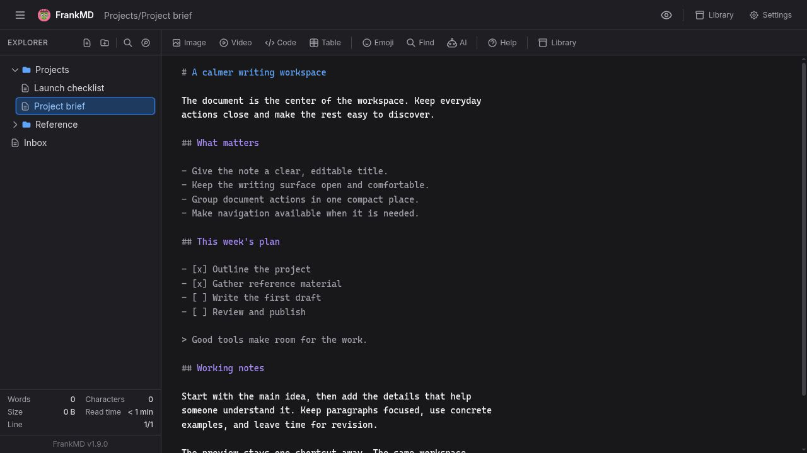
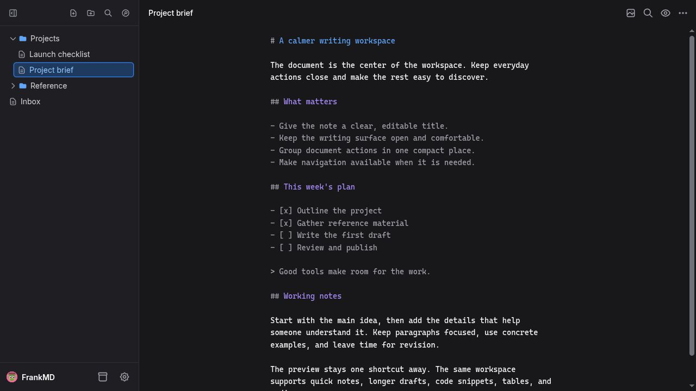
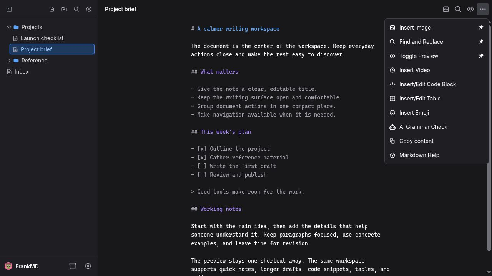

# A reduced, cleaner writing workspace

This implemented proposal puts the current document and writing surface first,
while keeping FrankMD's existing editing, preview, navigation, and media tools
available. The layout and default choices are presented for upstream discussion.

## Proposed interactions

- Rename a note directly in the document header. Enter or clicking away confirms;
  Escape cancels. Existing file operations handle validation and path changes.
- Use a compact row of icon buttons for document actions. The overflow menu keeps
  the remaining actions accessible and lets users pin actions to the header.
- Keep Explorer actions in the sidebar header, with branding, Library, and
  Settings in its footer. Closing Explorer hides the panel completely; its open
  button remains beside the document title. On small screens Explorer is an
  overlay that closes with Escape, the backdrop, or successful note selection.
- Share one document header between editing and preview, with preview zoom beside
  the action buttons. Editing actions are disabled in single-preview mode.
- Make document Stats optional and off by default, and put About inside Settings.
- Center the text column within the full editing pane, place the scrollbar at the
  pane edge, and keep the primary selection highlight close to the selected text.

## Visual comparison

Both desktop captures use the same synthetic sample notes, dark theme, and
1280-by-720 viewport. They contain no personal note content.

### Current upstream master

Captured from upstream commit `748a2542721ad7d4fd4baad7a807670f24ca32e9`.

### Proposed workspace

Captured from the implementation at `42eee69`.

### Document actions

Pinned actions stay in the header. Pin controls for unpinned actions appear when
the menu row is hovered or contains keyboard focus.

## Compatibility

The implementation reuses Rails partials and Stimulus controllers, preserves
keyboard shortcuts, autosave, local drafts, and single/split previews, and adds
strings to all seven supported locales. It adds no production dependencies,
routes, or file-format changes. Regression coverage includes inline rename,
workspace transitions, menu keyboard access, mobile overlays, and focus transfer
when resizing between mobile and desktop.
